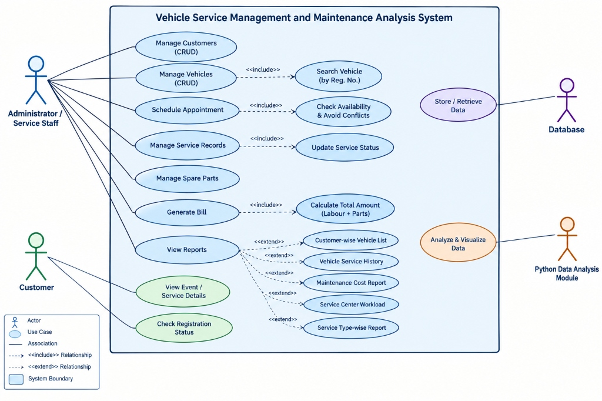
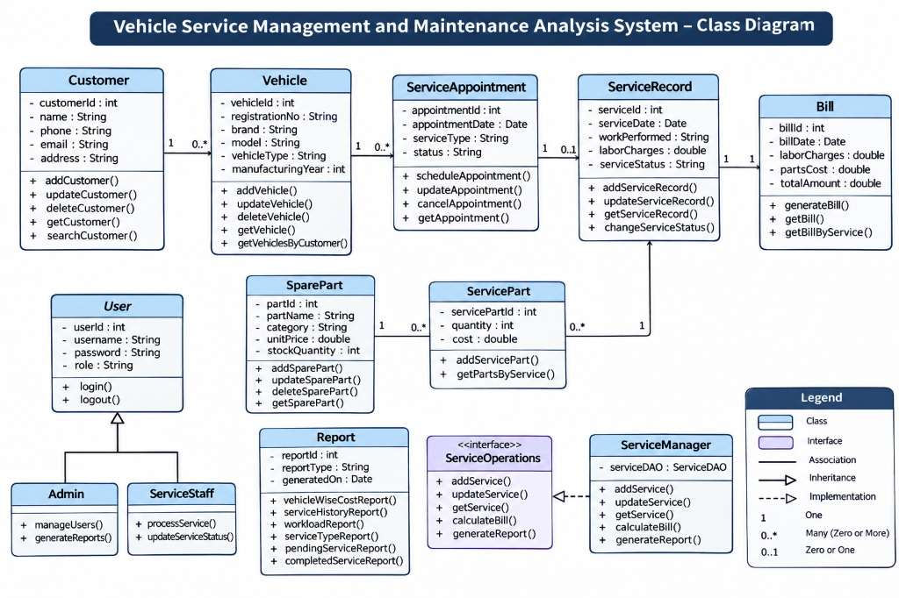
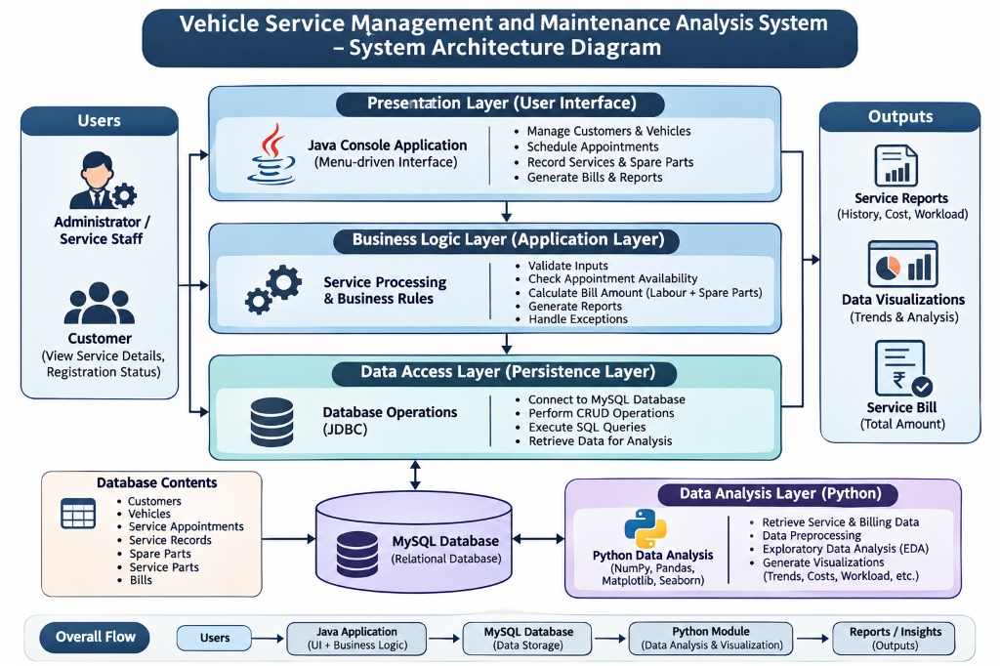
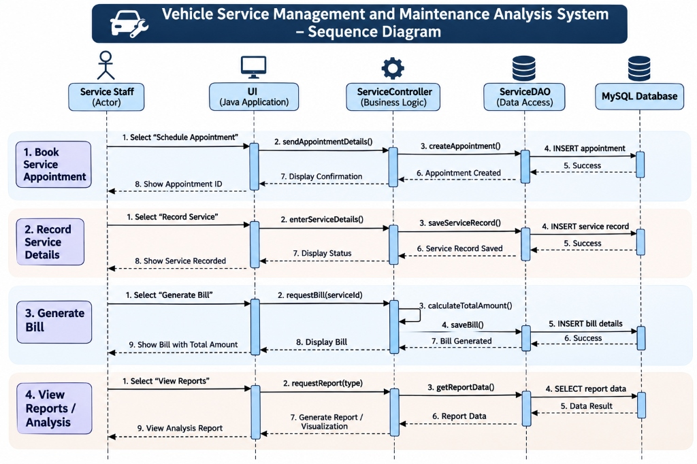
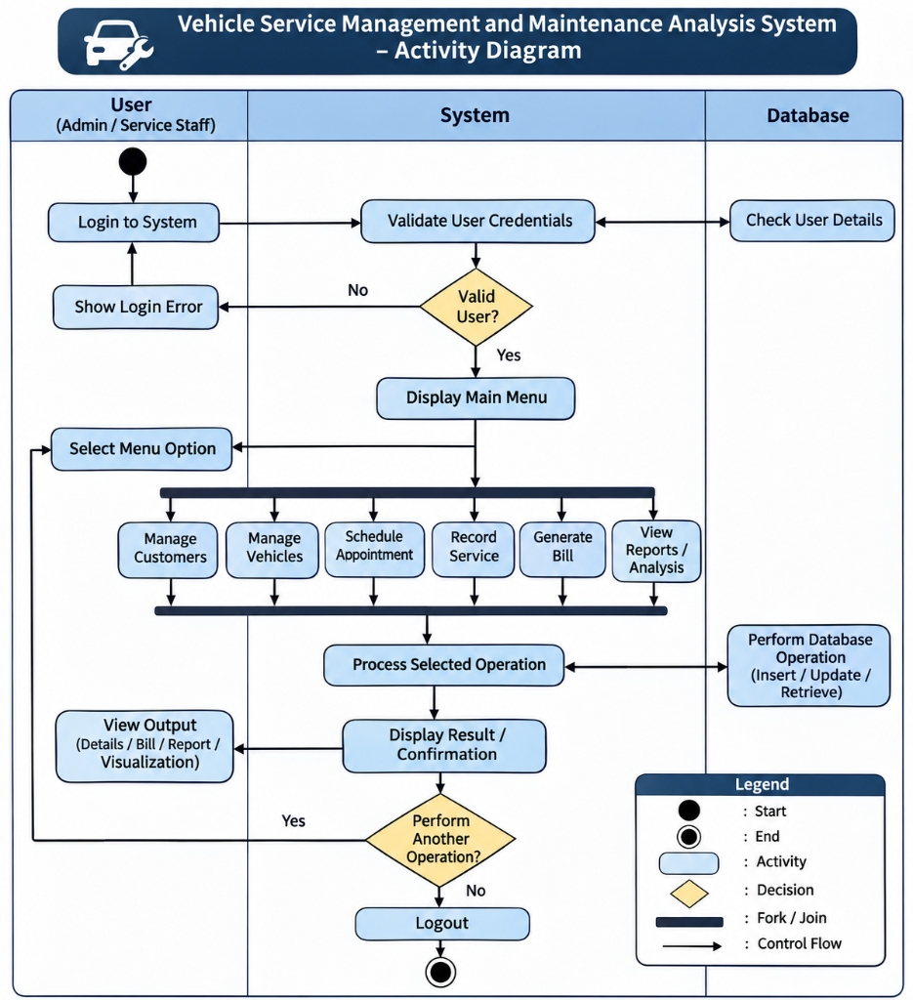
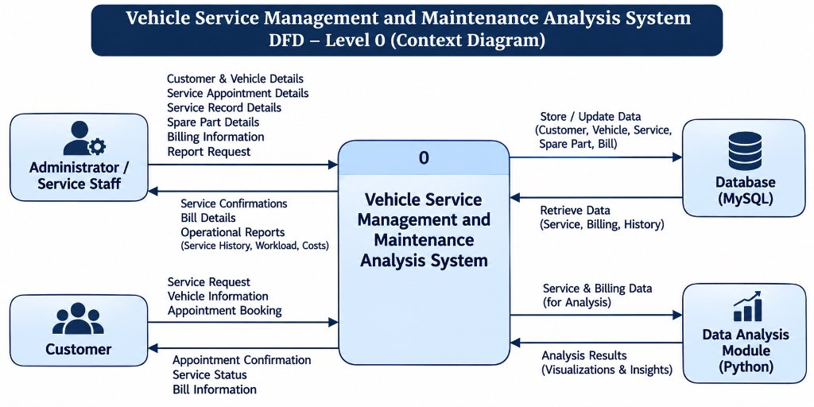
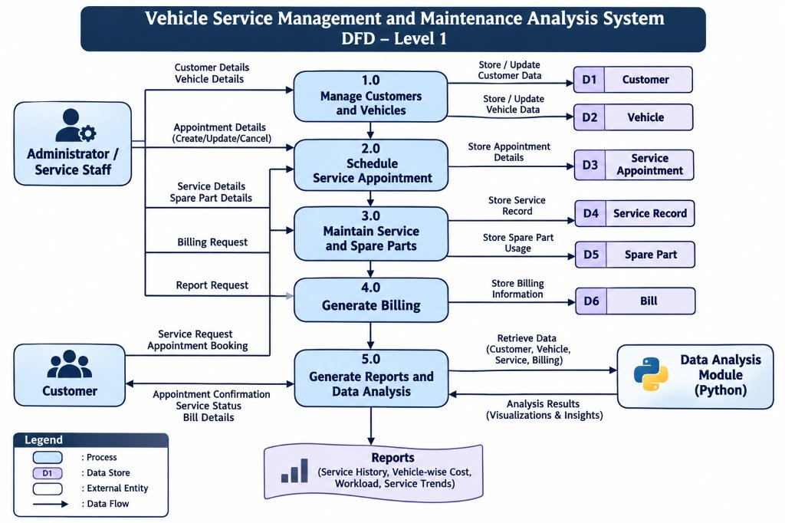

# Design Diagrams & System Architecture
## Vehicle Service Management and Maintenance Analysis System
**Department of Information Technology** | **Academic Year:** 2026-2027 (ODD)  
**Scenario Assignment:** Scenario 16 (Register Nos: 16, 46, 76, 106)  

---

## 1. Use Case Diagram

The Use Case Diagram defines the interactions between external actors (users and modules) and the system boundaries of the Vehicle Service Management and Maintenance Analysis System.

### 1.1 Identified Actors
1. **Administrator / Service Staff:** Performs customer and vehicle registration (CRUD), schedules appointments, records maintenance activities, allocates spare parts, generates invoices, and requests operational reports.
2. **Customer:** Submits service requests, views vehicle details, checks registration status, and receives billing information.
3. **Database (MySQL):** Persistent storage actor providing storage and retrieval of relational data.
4. **Python Data Analysis Module:** External analytics actor consuming service/billing data and delivering statistical visualizations.

### 1.2 Visual Use Case Diagram

### 1.3 Use Case Specifications & Relationships
- **<<include>> Relationships:**
  - `Manage Vehicles` $\xrightarrow{\text{<<include>>}}$ `Search Vehicle (by Reg. No.)`
  - `Schedule Appointment` $\xrightarrow{\text{<<include>>}}$ `Check Availability & Avoid Conflicts`
  - `Manage Service Records` $\xrightarrow{\text{<<include>>}}$ `Update Service Status`
  - `Generate Bill` $\xrightarrow{\text{<<include>>}}$ `Calculate Total Amount (Labour + Parts)`
- **<<extend>> Relationships:**
  - `View Reports` $\xleftarrow{\text{<<extend>>}}$ `Customer-wise Vehicle List`, `Vehicle Service History`, `Maintenance Cost Report`, `Service Center Workload`, `Service Type-wise Report`.

---

## 2. Class Diagram

The Class Diagram visualizes the Object-Oriented design, showing classes, attributes, visibility, method signatures, inheritance, and structural associations.

### 2.1 Visual Class Diagram

### 2.2 Key Class Descriptions
- **`Customer`:** Encapsulates owner profile (`customerId`, `name`, `phone`, `email`, `address`) with full CRUD operations.
- **`Vehicle`:** Represents automobile asset (`vehicleId`, `registrationNo`, `brand`, `model`, `vehicleType`, `manufacturingYear`) associated $1 : 0..*$ with Customer.
- **`ServiceAppointment`:** Represents scheduled bookings with status tracking (`SCHEDULED`, `COMPLETED`, `CANCELLED`).
- **`ServiceRecord`:** Manages executed repairs, labor hours, labor charges, technician notes, and maintenance status.
- **`SparePart` & `ServicePart`:** Manages parts catalog and parts consumption junction (`servicePartId`, `quantity`, `cost`).
- **`Bill`:** Handles financial invoice computation (`billId`, `laborCharges`, `partsCost`, `totalAmount`).
- **`User`, `Admin`, `ServiceStaff`:** Demonstrates OOP Inheritance for role-based system access.
- **`ServiceOperations` (Interface) & `ServiceManager`:** Implements interface-driven business operations and DAO abstraction.
- **`Report`:** Handles analytical report generation methods.

---

## 3. Overall System Architecture Diagram

The overall system architecture follows a **Decoupled Layered Enterprise Pattern** ensuring high maintainability, independent scalability, and clean separation of concerns.

### 3.1 Visual System Architecture Diagram

### 3.2 Layered Architecture Components
1. **Users & External Interfaces:** Administrator / Service Staff and Customers interacting with the system.
2. **Presentation Layer (User Interface):** Java Console Application providing an interactive menu-driven interface for customer management, scheduling, service logging, and report views.
3. **Business Logic Layer (Application Layer):** Validates inputs, checks appointment availability, enforces billing algorithms (Labor + Spare Parts + GST), and handles domain exceptions.
4. **Data Access Layer (Persistence Layer):** JDBC operations, DAO pattern, SQL execution, and database connection pooling.
5. **Relational Database (MySQL):** Normalized data storage holding `Customers`, `Vehicles`, `Service Appointments`, `Service Records`, `Spare Parts`, `Service Parts`, and `Bills`.
6. **Data Analysis Layer (Python):** Python Data Science engine (Pandas, NumPy, Matplotlib, Seaborn) retrieving database records, performing EDA, and generating statistical charts.
7. **Outputs:** Service Reports (History, Cost, Workload), Data Visualizations (Trends & Analysis), and Service Bills.

---

## 4. Sequence Diagram

The Sequence Diagram illustrates the chronological message exchange and interactions between actors and internal system components across four primary business workflows.

### 4.1 Visual Sequence Diagram

### 4.2 Sequence Workflows
1. **Workflow 1: Book Service Appointment:**
   - Service Staff selects "Schedule Appointment" $\rightarrow$ UI forwards details to `ServiceController` $\rightarrow$ `ServiceDAO.createAppointment()` $\rightarrow$ MySQL `INSERT` $\rightarrow$ Success confirmation returned to Staff.
2. **Workflow 2: Record Service Details:**
   - Staff inputs service record $\rightarrow$ `ServiceController.saveServiceRecord()` $\rightarrow$ `ServiceDAO` performs `INSERT` into `service_records` $\rightarrow$ Live status confirmed.
3. **Workflow 3: Generate Bill:**
   - Billing request initiated $\rightarrow$ `ServiceController.calculateTotalAmount()` $\rightarrow$ `saveBill()` $\rightarrow$ MySQL `INSERT` into `bills` table $\rightarrow$ Total amount displayed and invoice issued.
4. **Workflow 4: View Reports / Analysis:**
   - Report request passed to `ServiceDAO.getReportData()` $\rightarrow$ MySQL `SELECT` $\rightarrow$ Python visualization pipeline generates report and displays insights.

---

## 5. Activity Diagram

The Activity Diagram models the dynamic operational workflow, user authentication, decision branching, and concurrency forks/joins.

### 5.1 Visual Activity Diagram

### 5.2 Activity Workflow Steps
1. **User Authentication:** Admin/Staff enters login credentials $\rightarrow$ System queries database $\rightarrow$ Validates user (branch: error prompt on invalid credentials, or display main menu).
2. **Menu Selection & Concurrency Fork:** User selects from 6 parallel operations:
   - Manage Customers
   - Manage Vehicles
   - Schedule Appointment
   - Record Service
   - Generate Bill
   - View Reports / Analysis
3. **Operation Processing (Join):** System executes business logic, invokes database CRUD operations (Insert / Update / Retrieve).
4. **Result Presentation:** Confirmation / Bill / Report / Visualization presented to user.
5. **Session Decision:** User decides whether to perform another operation (loops back to main menu) or logout and terminate.

---

## 6. Data Flow Diagrams (DFD)

Data Flow Diagrams graphically represent how data moves through the system, external entities, business processes, and persistent data stores.

### 6.1 DFD - Level 0 (Context Diagram)
The Context Diagram establishes the fundamental system boundary, inputs, and outputs connecting external entities.

- **External Entities:**
  - `Administrator / Service Staff`: Supplies customer/vehicle details, appointments, records, parts, and billing info; receives confirmations, bills, and operational reports.
  - `Customer`: Submits service requests; receives appointment confirmations, service status, and bill details.
  - `Database (MySQL)`: Stores and updates records; provides historical data retrieval.
  - `Data Analysis Module (Python)`: Receives service & billing datasets; produces visualizations and insights.

---

### 6.2 DFD - Level 1 (Detailed Data Flow Diagram)
Level 1 decomposes the central system into five core functional processes and maps interactions with specific relational data stores ($D_1$ to $D_6$).

- **Processes & Data Stores:**
  1. **Process 1.0 (Manage Customers and Vehicles):** Stores/updates data in $D_1$ (`Customer`) and $D_2$ (`Vehicle`).
  2. **Process 2.0 (Schedule Service Appointment):** Validates and writes booking details to $D_3$ (`Service Appointment`).
  3. **Process 3.0 (Maintain Service and Spare Parts):** Records maintenance activities in $D_4$ (`Service Record`) and part allocations in $D_5$ (`Spare Part`).
  4. **Process 4.0 (Generate Billing):** Computes labor + parts total and records financial ledger in $D_6$ (`Bill`).
  5. **Process 5.0 (Generate Reports and Data Analysis):** Ingests records across data stores, interfaces with Python Data Analysis module, and produces operational reports.
