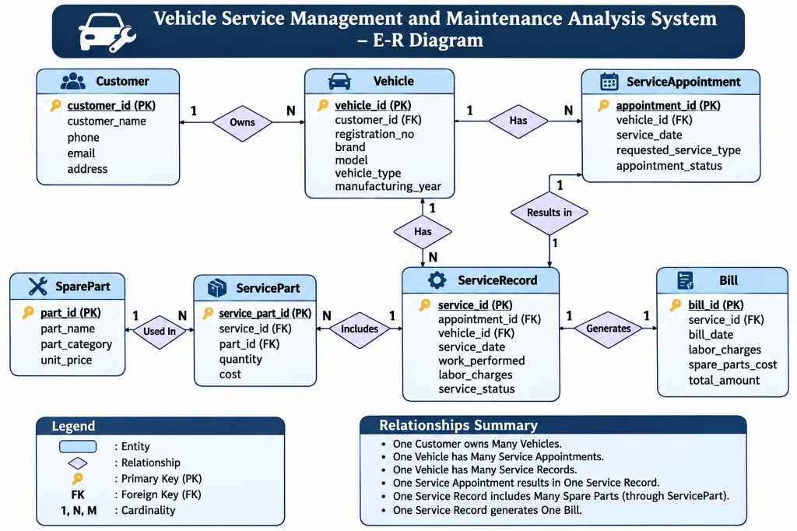
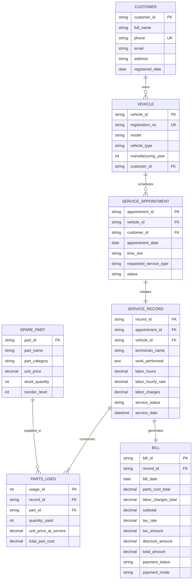

# Entity-Relationship (ER) Diagram and Relational Model
## Vehicle Service Management and Maintenance Analysis System
**Department of Information Technology** | **Academic Year:** 2026-2027 (ODD)  
**Course Code & Title:** 25ITT31 – Database Management Systems  
**Scenario Assignment:** Scenario 16 (Register Nos: 16, 46, 76, 106)  

---

## 1. Entity-Relationship (ER) Model

### 1.1 Identified Entities & Classification
1. **CUSTOMER (Strong Entity):** Represents registered automobile owners.
2. **VEHICLE (Strong Entity):** Represents motor vehicles brought in for service.
3. **SERVICE_APPOINTMENT (Strong Entity):** Represents service reservations booked for a given date and slot.
4. **SERVICE_RECORD (Strong Entity):** Represents physical maintenance performed on a vehicle.
5. **SPARE_PART (Strong Entity):** Represents inventory of replacement automotive components.
6. **PARTS_USED (Associative Entity / Weak Relationship Junction):** Captures the Many-to-Many ($M:N$) resolution between `SERVICE_RECORD` and `SPARE_PART`.
7. **BILL (Strong Entity):** Represents the fiscal transaction, tax calculation, and payment status for a completed service.

---

### 1.2 Visual E-R Diagram

### 1.3 ER Diagram (Mermaid Representation)

---

## 2. Cardinality & Participation Constraints

| Relationship | Cardinality | Participation Ratio | Structural Constraint Explanation |
|---|---|---|---|
| `CUSTOMER` $\leftrightarrow$ `VEHICLE` | $1 : N$ | Partial for Customer, Total for Vehicle | A customer can register zero or multiple vehicles; every vehicle must belong to exactly one customer. |
| `VEHICLE` $\leftrightarrow$ `SERVICE_APPOINTMENT` | $1 : N$ | Partial for Vehicle, Total for Appointment | A vehicle may have zero, one, or multiple service appointments over its lifespan; an appointment must reference a valid vehicle. |
| `SERVICE_APPOINTMENT` $\leftrightarrow$ `SERVICE_RECORD` | $1 : 1$ | Partial for Appointment, Total for Service Record | A scheduled appointment eventually yields exactly one maintenance service record upon technician intake. |
| `SERVICE_RECORD` $\leftrightarrow$ `SPARE_PART` | $M : N$ | Resolved via `PARTS_USED` | A service record may use multiple spare parts; a spare part can be installed across multiple service records. |
| `SERVICE_RECORD` $\leftrightarrow$ `BILL` | $1 : 1$ | Partial for Service Record, Total for Bill | A completed service record generates exactly one final invoice. |

---

## 3. Relational Schema & Data Dictionary

### Table 1: `customers`
- **Primary Key:** `customer_id`
- **Indexes:** `idx_customer_phone` (`phone`)

| Column Name | Data Type | Nullable | Default | Constraints / Description |
|---|---|---|---|---|
| `customer_id` | `VARCHAR(15)` | NO | None | Primary Key (e.g., `CUST-1001`) |
| `full_name` | `VARCHAR(100)` | NO | None | Full legal name of vehicle owner |
| `phone` | `VARCHAR(15)` | NO | None | UNIQUE, 10-digit mobile number |
| `email` | `VARCHAR(100)` | YES | NULL | Valid email address |
| `address` | `VARCHAR(255)` | YES | NULL | Residential or business address |
| `registered_date` | `DATE` | NO | `CURRENT_DATE` | Date of customer registration |

### Table 2: `vehicles`
- **Primary Key:** `vehicle_id`
- **Foreign Key:** `customer_id` references `customers(customer_id)` ON DELETE RESTRICT ON UPDATE CASCADE
- **Indexes:** `idx_vehicles_reg_no` (`registration_no`), `idx_vehicles_owner` (`customer_id`)

| Column Name | Data Type | Nullable | Default | Constraints / Description |
|---|---|---|---|---|
| `vehicle_id` | `VARCHAR(15)` | NO | None | Primary Key (e.g., `VEH-101`) |
| `registration_no`| `VARCHAR(20)` | NO | None | UNIQUE Vehicle Registration (e.g., `TN-33-AB-1234`) |
| `model` | `VARCHAR(100)` | NO | None | Make and Model (e.g., `Hyundai Creta`) |
| `vehicle_type` | `VARCHAR(20)` | NO | None | CHECK (`vehicle_type` IN ('SEDAN','SUV','HATCHBACK','TRUCK','TWO_WHEELER')) |
| `manufacturing_year`| `INT` | NO | None | CHECK (`manufacturing_year` BETWEEN 1980 AND 2027) |
| `customer_id` | `VARCHAR(15)` | NO | None | Foreign Key referencing `customers(customer_id)` |

### Table 3: `spare_parts`
- **Primary Key:** `part_id`

| Column Name | Data Type | Nullable | Default | Constraints / Description |
|---|---|---|---|---|
| `part_id` | `VARCHAR(15)` | NO | None | Primary Key (e.g., `PRT-01`) |
| `part_name` | `VARCHAR(100)` | NO | None | Commercial name of automotive component |
| `part_category` | `VARCHAR(50)` | NO | None | e.g., `Fluids`, `Brakes`, `Filters`, `Electrical` |
| `unit_price` | `DECIMAL(10,2)`| NO | 0.00 | CHECK (`unit_price` >= 0) |
| `stock_quantity`| `INT` | NO | 0 | CHECK (`stock_quantity` >= 0) |
| `reorder_level` | `INT` | NO | 5 | Minimum threshold before triggering reorder |

### Table 4: `service_appointments`
- **Primary Key:** `appointment_id`
- **Foreign Keys:** `vehicle_id` references `vehicles(vehicle_id)`, `customer_id` references `customers(customer_id)`

| Column Name | Data Type | Nullable | Default | Constraints / Description |
|---|---|---|---|---|
| `appointment_id` | `VARCHAR(15)` | NO | None | Primary Key (e.g., `APT-301`) |
| `vehicle_id` | `VARCHAR(15)` | NO | None | Foreign Key referencing `vehicles(vehicle_id)` |
| `customer_id` | `VARCHAR(15)` | NO | None | Foreign Key referencing `customers(customer_id)` |
| `appointment_date`| `DATE` | NO | None | Scheduled service date |
| `time_slot` | `VARCHAR(20)` | NO | None | e.g., `09:00 AM - 11:00 AM` |
| `requested_service_type`| `VARCHAR(100)`| NO | None | e.g., `Periodic Maintenance`, `Brake Repair` |
| `status` | `VARCHAR(20)` | NO | 'SCHEDULED' | CHECK (`status` IN ('SCHEDULED','IN_PROGRESS','COMPLETED','CANCELLED')) |

### Table 5: `service_records`
- **Primary Key:** `record_id`
- **Foreign Keys:** `appointment_id` references `service_appointments(appointment_id)`, `vehicle_id` references `vehicles(vehicle_id)`

| Column Name | Data Type | Nullable | Default | Constraints / Description |
|---|---|---|---|---|
| `record_id` | `VARCHAR(15)` | NO | None | Primary Key (e.g., `SRV-501`) |
| `appointment_id` | `VARCHAR(15)` | NO | None | Foreign Key referencing `service_appointments` |
| `vehicle_id` | `VARCHAR(15)` | NO | None | Foreign Key referencing `vehicles` |
| `technician_name`| `VARCHAR(100)` | NO | None | Lead technician assigned to job |
| `work_performed` | `TEXT` | NO | None | Detailed summary of repairs executed |
| `labor_hours` | `DECIMAL(5,2)` | NO | 1.00 | CHECK (`labor_hours` >= 0) |
| `labor_hourly_rate`| `DECIMAL(10,2)`| NO | 500.00 | Hourly standard workshop rate |
| `labor_charges` | `DECIMAL(10,2)`| NO | None | Computed: `labor_hours` * `labor_hourly_rate` |
| `service_status` | `VARCHAR(20)` | NO | 'IN_PROGRESS' | CHECK (`service_status` IN ('IN_PROGRESS','COMPLETED','ON_HOLD')) |
| `service_date` | `DATETIME` | NO | `CURRENT_TIMESTAMP` | Timestamp of maintenance recording |

### Table 6: `parts_used`
- **Primary Key:** `usage_id` (AUTO_INCREMENT)
- **Foreign Keys:** `record_id` references `service_records(record_id)`, `part_id` references `spare_parts(part_id)`

| Column Name | Data Type | Nullable | Default | Constraints / Description |
|---|---|---|---|---|
| `usage_id` | `INT` | NO | AUTO_INC | Surrogate Primary Key |
| `record_id` | `VARCHAR(15)` | NO | None | Foreign Key referencing `service_records` |
| `part_id` | `VARCHAR(15)` | NO | None | Foreign Key referencing `spare_parts` |
| `quantity_used` | `INT` | NO | 1 | CHECK (`quantity_used` > 0) |
| `unit_price_at_service`| `DECIMAL(10,2)`| NO | None | Frozen unit price at time of job |
| `total_part_cost`| `DECIMAL(10,2)`| NO | None | `quantity_used` * `unit_price_at_service` |

### Table 7: `bills`
- **Primary Key:** `bill_id`
- **Foreign Key:** `record_id` references `service_records(record_id)`

| Column Name | Data Type | Nullable | Default | Constraints / Description |
|---|---|---|---|---|
| `bill_id` | `VARCHAR(15)` | NO | None | Primary Key (e.g., `BIL-801`) |
| `record_id` | `VARCHAR(15)` | NO | None | UNIQUE Foreign Key referencing `service_records` |
| `bill_date` | `DATE` | NO | `CURRENT_DATE` | Date bill was finalized |
| `parts_cost_total`| `DECIMAL(10,2)`| NO | 0.00 | Sum of all `total_part_cost` in `parts_used` |
| `labor_charges_total`| `DECIMAL(10,2)`| NO | 0.00 | From `service_records.labor_charges` |
| `subtotal` | `DECIMAL(10,2)`| NO | None | `parts_cost_total` + `labor_charges_total` |
| `tax_rate` | `DECIMAL(5,2)` | NO | 18.00 | Applicable GST percentage |
| `tax_amount` | `DECIMAL(10,2)`| NO | None | `(subtotal - discount_amount) * (tax_rate / 100)` |
| `discount_amount`| `DECIMAL(10,2)`| NO | 0.00 | Promotional or loyalty deduction |
| `total_amount` | `DECIMAL(10,2)`| NO | None | `(subtotal - discount_amount) + tax_amount` |
| `payment_status` | `VARCHAR(20)` | NO | 'PAID' | CHECK (`payment_status` IN ('PAID','PENDING','REFUNDED')) |
| `payment_mode` | `VARCHAR(20)` | NO | 'CASH' | CHECK (`payment_mode` IN ('CASH','CARD','UPI','NET_BANKING')) |
